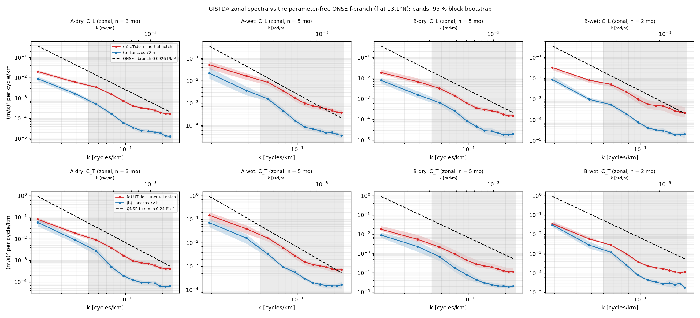
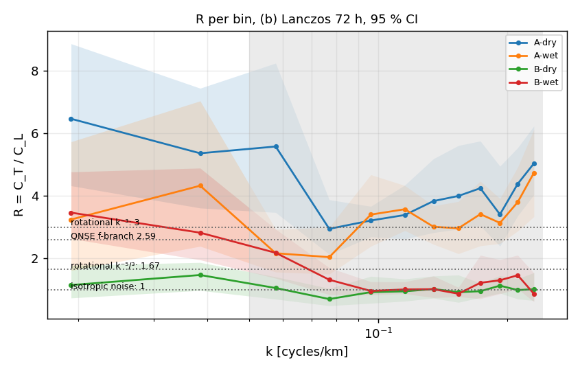
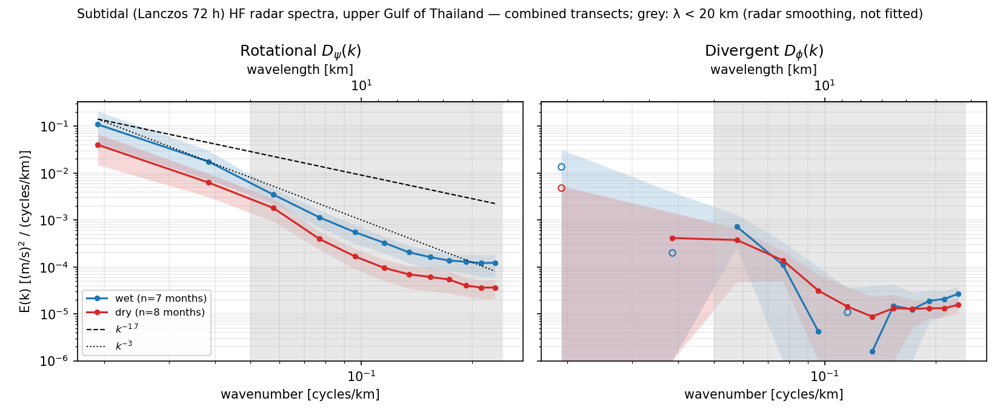
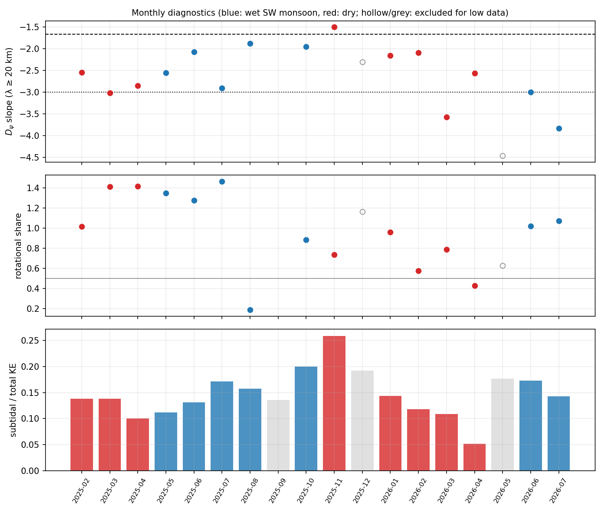

# Subtidal rotational spectra of HF radar currents — upper Gulf of Thailand

_Generated 2026-10-22 04:19 UTC by `tools/hfr_report.py` from 18 monthly GISTDA HF radar files (2025-02 – 2026-07)._

## Summary of findings

_Curated interpretation (analysis/report/notes.md); the tables below are regenerated by `tools/hfr_report.py`._

1. **Data.** 18 monthly GISTDA total-vector files (Feb 2025 – Jul 2026), 2 km native grid. Two caveats:
   * **Configuration change.** The footprint changed in Nov 2025: configuration A (to Oct 2025) is
     74–82 km E–W by 42–54 km N–S; configuration B (from Nov 2025) is 54–64 km by 50–64 km and extends
     further south, to 12.69°N.
   * **Missing months.** Sep 2025 is a near-outage (22 km footprint). Dec 2025 and May 2026 are too
     fragmented after filtering. These three months are excluded, leaving 15.
2. **Tides and inertial motions dominate.** The subtidal band (> 72 h Lanczos, which also removes the
   53 h inertial band) holds only **5–26 % of surface-current kinetic energy** (median ≈ 14 %).
3. **Rotational spectra are steep.**
   * Over 26–52 km wavelengths the subtidal rotational spectrum D_ψ falls as **k^−2.6 to k^−2.7**
     in both seasons, with 95 % bootstrap intervals ending at about −2.1.
   * The estimator was validated on synthetic months with the real gap mask. Its single-month bias
     is +0.06 for a true k^−5/3 and −0.30 for a true k^−3. A **k^−5/3 rotational range is therefore
     not supported** at these scales.
   * The estimate is closer to the enstrophy-cascade or smooth-flow slope (−3), but a two-bin fit
     cannot pin it to −3.
4. **No seasonal difference in slope.** Wet − dry = +0.05 (95 % CI −0.57 … +0.61).
5. **Wet-season rotational energy is higher.** Rotational KE at λ ≥ 20 km is ≈ 2.7× higher in the
   SW (wet) monsoon overall.
   * The pooled 95 % interval (≈ 0.9 … 8) includes 1, because season is confounded with the
     configuration change: configuration B is 3–6× less energetic than A.
   * Within each configuration the direction is the same: ×1.7 in A (intervals overlap) and ×2.5
     in B (intervals separate, but only 2 wet months).
   * Treat it as a consistent signal to confirm with the next wet season, not yet a significant
     result.
6. **Rotational vs divergent split.**
   * Where both transect directions contribute (configuration B), the rotational share at 26–52 km
     is ≈ 0.7 (dry season), so about 30 % of subtidal energy at these scales is divergent:
     wind-driven, plume and frontal, or coastal-convergence motion rather than geostrophic.
   * In configuration A the 1-D (Bühler et al. 2014) split returns shares above 1. That is the
     signature of anisotropic flow, which violates the method's isotropy assumption, so those shares
     are not interpretable.

### Implications for the QNSE comparison

* **What is tested.** The QNSE one-dimensional spectra of Galperin & Sukoriansky (2020, *Phys. Rev.
  Fluids* 5, 063803), eqs. (17)–(18):
  E_L = (18/55) C_K Π^(2/3) k^−5/3 + 0.0926 f² k^−3 and E_T = (24/55) C_K Π^(2/3) k^−5/3 + 0.24 f² k^−3.
  * These spectra are **horizontally isotropic and contain no β term**, so they can be compared
    directly with the radar spectra at 26–52 km. No β-plane or Rhines-scale argument is involved.
    This replaces the earlier statement that QNSE's relevant anisotropy acts at Rhines scales.
  * The citation was checked; the full text was not available here. The coefficients are those in
    Galperin's IOVWST 2022 slides, and the equation numbers are as given by the requester.
* **Amplitude.** In all four season × configuration groups and with both time filters, the zonal
  C_L and C_T at 26–52 km lie **below the parameter-free f-branch**: obs/QNSE = 0.02–0.08 with the
  72 h Lanczos filter, and 0.02–0.36 with UTide detiding plus the inertial notch.
  * QNSE adds a non-negative k^−5/3 term to the f-branch, so **no Π ≥ 0 can reconcile these spectra
    with eqs. (17)–(18)**. No fit was attempted.
* **Ratio R = C_T/C_L.** The f-branch predicts R = 0.24/0.0926 = 2.59; isotropic non-divergent
  spectra give 1.67 (k^−5/3) to 3 (k^−3).
  * Configuration A: R = 2.4–6.5 at 26–52 km. The 72 h dry-season values (5.4–6.5, 95 % CIs entirely
    above 3) exceed any isotropic value: transverse (north–south) motion dominates the zonal transects.
  * Configuration B: R = 0.7–1.5 (dry) and up to 3.5 (wet, 72 h).
  * Only configuration A in the wet season with filter (a) has R consistent with 2.59 (2.4–2.8), and
    its amplitude is still 0.15–0.36 of the f-branch.
  * Validation: the R estimator is unbiased for k^−5/3 (±0.04) and reads 0.5–0.7 low for a rotational
    k^−3 field, with single-month scatter 0.3–1.7.
* **Time filter.** Keeping the non-tidal motions faster than 72 h (filter a) raises C_L by 2.2–8.4×
  and C_T by 1.2–2.5× at 26–52 km. The spectra remain below the f-branch.
* **Bottom friction.** The UTide tidal-current RMS speed is 0.13–0.24 m/s (mean 0.178 m/s).
  * Assumptions: quadratic drag C_d = 2.5 × 10⁻³ and depth H = 15 m (range 10–25 m) for the Bight of
    Bangkok.
  * Result: r = C_d U_tide / H = 3.0 × 10⁻⁵ s⁻¹, so **r/f ≈ 0.9** (0.54–1.34 for H = 25–10 m; ≈ 0.77
    with the Lorentz factor 8/3π).
  * Configuration A has stronger tides (0.19–0.24 m/s) than B (0.13–0.18 m/s).
  * Interpretation (a hypothesis, not a test): frictional spin-down is as fast as the inertial time
    scale, so in this shallow, strongly tidal bight rotation does not dominate the resolved dynamics.
    That is a physical reason why an f-controlled (Coriolis) range need not appear.
* **Bottom line.** At 13.1°N, the upper-Gulf surface currents do not follow the QNSE f-branch at
  26–52 km: they are 3–50× weaker, frequently anisotropic, and r ≈ f. This agrees with the 13–45°N
  HFRNet comparison, where the energy at 50 km scales as f^p with p ≈ 0 and p = 2 is excluded.

### Remaining caveats and next steps

* **Radar smoothing scale.** The 20 km fit floor assumes the total-vector smoothing is ≲ 10 km.
  Ask GISTDA for the totals' search radius. If it is larger, the 26 km bin is attenuated and the
  slopes are biased steep.
* **Few bins.** Only two spectral bins exceed 20 km in the configuration-B footprint. Slopes are
  meaningful only as multi-month averages.
* **Isotropy.** A 2-D decomposition that does not assume isotropy is the natural next step:
  open-boundary modal analysis (OMA; Lekien et al. 2004, Kaplan & Lekien 2007) is standard for HF
  radar and would also resolve the anisotropy seen in configuration A.
* **Larger scales.** Altimetry or SWOT would extend the spectra beyond the 52 km segment limit and
  test whether the f-branch amplitude is reached at scales the radar cannot resolve.

## QNSE comparison for the Gulf of Thailand (13.1°N) — follow-up analysis

_Generated by `tools/hfr_qnse_gistda.py`. Figures and CSV in `analysis/qnse_gistda/`._

### 1. Spectral convention and Parseval check

* One-sided wavenumber spectra; k in cycles/km (rad/m given alongside: k_rad = 2πk/1000), E in (m/s)² per
  cycle/km (rad/m: E_rad = E·1000/2π, units m³/s²).
* Each 52 km zonal segment is de-meaned (not detrended), Tukey(0.5)-tapered, transformed, scaled by
  Δx/(L⟨w²⟩) and doubled except DC and Nyquist, so ∫E dk = ⟨(d·w)²⟩/⟨w²⟩: the taper loss is corrected.
* Parseval check, ∫C dk / ⟨u²⟩ over all bins (DC to Nyquist), per group:

| Filter | Group | Segments | 7-day blocks | untapered ∫C_L dk/⟨u_L²⟩ | untapered T | tapered ∫C_L dk/⟨u_L²⟩ | tapered T |
|---|---|---|---|---|---|---|---|
| (b) Lanczos 72 h | A-dry | 14,842 | 13 | 1.0000 | 1.0000 | 0.787 | 1.063 |
| (b) Lanczos 72 h | A-wet | 8,331 | 17 | 1.0000 | 1.0000 | 0.785 | 0.951 |
| (b) Lanczos 72 h | B-dry | 11,693 | 15 | 1.0000 | 1.0000 | 0.718 | 0.693 |
| (b) Lanczos 72 h | B-wet | 4,489 | 6 | 1.0000 | 1.0000 | 0.528 | 0.795 |
| (a) UTide + inertial notch | A-dry | 10,171 | 10 | 1.0000 | 1.0000 | 0.904 | 0.875 |
| (a) UTide + inertial notch | A-wet | 5,191 | 13 | 1.0000 | 1.0000 | 0.877 | 0.851 |
| (a) UTide + inertial notch | B-dry | 7,266 | 13 | 1.0000 | 1.0000 | 0.712 | 0.704 |
| (a) UTide + inertial notch | B-wet | 2,289 | 4 | 1.0000 | 1.0000 | 0.590 | 0.717 |

* **Untapered = 1.0000** verifies the one-sided normalisation exactly (DFT Parseval).
* **Tapered < 1** (real data 0.53–1.06; homogeneous synthetic fields 0.61–0.83 in section 7, lower for k⁻³ than
  for k⁻⁵/³). The ⟨w²⟩ correction is exact only for variance spread evenly along the segment. Energy at scales
  longer than the 52 km segment appears as a gradient across it, concentrated at the segment ends where the
  Tukey taper down-weights it, so that part of ⟨u²⟩ is not recovered. The synthetic ensemble includes this
  effect, so the validated biases in section 7 already account for it. Spectra are not rescaled.

### 2. Parameter-free QNSE f-branch versus observations (zonal, per season and configuration)

f = 2Ω sin 13.1° = 3.306e-05 s⁻¹. f-branch: 0.0926 f²k⁻³ (C_L) and 0.24 f²k⁻³ (C_T), k in rad/m, converted
to cycles/km. "obs/QNSE" is the observed spectrum divided by the f-branch in each bin (λ ≥ 20 km in bold).

**(a) UTide + inertial notch**

| Group | λ [km] | C_L (95 % CI) | obs/QNSE (L) | C_T (95 % CI) | obs/QNSE (T) | R = C_T/C_L (95 % CI) |
|---|---|---|---|---|---|---|
| A-dry | **52.0** | 0.0201 [0.0168, 0.0234] | **0.056** | 0.0795 [0.0635, 0.0947] | **0.085** | 3.95 [3.61, 4.31] |
| A-dry | **26.0** | 0.00608 [0.00538, 0.00722] | **0.135** | 0.0185 [0.0155, 0.0213] | **0.158** | 3.04 [2.60, 3.43] |
| A-dry | 17.3 | 0.00339 [0.00311, 0.00379] | 0.254 | 0.00883 [0.00742, 0.0106] | 0.255 | 2.60 [2.26, 2.92] |
| A-dry | 13.0 | 0.00152 [0.00139, 0.00172] | 0.270 | 0.00374 [0.00325, 0.00437] | 0.256 | 2.46 [2.20, 2.68] |
| A-dry | 10.4 | 0.000712 [0.000639, 0.000828] | 0.247 | 0.00167 [0.00145, 0.00199] | 0.224 | 2.35 [2.09, 2.58] |
| A-wet | **52.0** | 0.0524 [0.0332, 0.0737] | **0.145** | 0.147 [0.0955, 0.196] | **0.157** | 2.80 [1.87, 3.57] |
| A-wet | **26.0** | 0.0164 [0.0113, 0.0219] | **0.364** | 0.0396 [0.0246, 0.0557] | **0.339** | 2.41 [1.73, 2.88] |
| A-wet | 17.3 | 0.00856 [0.00627, 0.0109] | 0.641 | 0.0158 [0.0114, 0.0192] | 0.458 | 1.85 [1.49, 2.15] |
| A-wet | 13.0 | 0.00361 [0.00263, 0.00462] | 0.641 | 0.00625 [0.00468, 0.00774] | 0.428 | 1.73 [1.42, 1.94] |
| A-wet | 10.4 | 0.00167 [0.00121, 0.00216] | 0.578 | 0.0028 [0.00212, 0.00351] | 0.375 | 1.68 [1.36, 1.95] |
| B-dry | **52.0** | 0.0189 [0.016, 0.0262] | **0.052** | 0.0184 [0.015, 0.0271] | **0.020** | 0.97 [0.89, 1.10] |
| B-dry | **26.0** | 0.00677 [0.00532, 0.00987] | **0.150** | 0.0054 [0.00412, 0.00933] | **0.046** | 0.80 [0.68, 0.99] |
| B-dry | 17.3 | 0.00322 [0.00262, 0.00429] | 0.241 | 0.00218 [0.00172, 0.00355] | 0.063 | 0.68 [0.55, 0.87] |
| B-dry | 13.0 | 0.00141 [0.00117, 0.0018] | 0.251 | 0.000952 [0.000724, 0.00154] | 0.065 | 0.67 [0.54, 0.90] |
| B-dry | 10.4 | 0.000619 [0.000518, 0.000776] | 0.215 | 0.000449 [0.000325, 0.000752] | 0.060 | 0.73 [0.54, 1.05] |
| B-wet | **52.0** | 0.033 [0.0254, 0.0362] | **0.092** | 0.0354 [0.0304, 0.0485] | **0.038** | 1.07 [0.84, 1.80] |
| B-wet | **26.0** | 0.00824 [0.00615, 0.00886] | **0.183** | 0.00576 [0.0053, 0.00723] | **0.049** | 0.70 [0.62, 1.18] |
| B-wet | 17.3 | 0.00515 [0.004, 0.00573] | 0.386 | 0.00278 [0.00267, 0.00282] | 0.080 | 0.54 [0.49, 0.67] |
| B-wet | 13.0 | 0.00228 [0.00149, 0.00291] | 0.404 | 0.00101 [0.000743, 0.00112] | 0.069 | 0.44 [0.29, 0.50] |
| B-wet | 10.4 | 0.000994 [0.000641, 0.00157] | 0.345 | 0.000378 [0.00034, 0.000406] | 0.051 | 0.38 [0.26, 0.53] |

* (a) UTide + inertial notch, A-dry: the observed spectrum lies **below** the QNSE f-branch in the fitted band. Because QNSE adds a non-negative Kolmogorov term to the f-branch, **no Π ≥ 0 can fit**; no fit is attempted.
* (a) UTide + inertial notch, A-wet: the observed spectrum lies **below** the QNSE f-branch in the fitted band. Because QNSE adds a non-negative Kolmogorov term to the f-branch, **no Π ≥ 0 can fit**; no fit is attempted.
* (a) UTide + inertial notch, B-dry: the observed spectrum lies **below** the QNSE f-branch in the fitted band. Because QNSE adds a non-negative Kolmogorov term to the f-branch, **no Π ≥ 0 can fit**; no fit is attempted.
* (a) UTide + inertial notch, B-wet: the observed spectrum lies **below** the QNSE f-branch in the fitted band. Because QNSE adds a non-negative Kolmogorov term to the f-branch, **no Π ≥ 0 can fit**; no fit is attempted.

**(b) Lanczos 72 h**

| Group | λ [km] | C_L (95 % CI) | obs/QNSE (L) | C_T (95 % CI) | obs/QNSE (T) | R = C_T/C_L (95 % CI) |
|---|---|---|---|---|---|---|
| A-dry | **52.0** | 0.00897 [0.00681, 0.0116] | **0.025** | 0.0579 [0.0383, 0.0808] | **0.062** | 6.46 [4.32, 8.86] |
| A-dry | **26.0** | 0.00167 [0.00131, 0.00205] | **0.037** | 0.00897 [0.00631, 0.0123] | **0.077** | 5.36 [3.61, 7.44] |
| A-dry | 17.3 | 0.000496 [0.000401, 0.000619] | 0.037 | 0.00276 [0.00175, 0.00411] | 0.080 | 5.58 [3.47, 8.24] |
| A-dry | 13.0 | 0.000166 [0.000136, 0.000199] | 0.030 | 0.00049 [0.000364, 0.000621] | 0.034 | 2.95 [2.13, 3.88] |
| A-dry | 10.4 | 6e-05 [5.09e-05, 7.02e-05] | 0.021 | 0.000193 [0.00016, 0.000234] | 0.026 | 3.21 [2.69, 3.67] |
| A-wet | **52.0** | 0.022 [0.0125, 0.0384] | **0.061** | 0.0714 [0.0463, 0.101] | **0.076** | 3.24 [1.62, 5.73] |
| A-wet | **26.0** | 0.00368 [0.00226, 0.00559] | **0.082** | 0.0159 [0.00935, 0.0236] | **0.136** | 4.33 [2.39, 7.03] |
| A-wet | 17.3 | 0.00155 [0.00122, 0.00202] | 0.116 | 0.00337 [0.00254, 0.00431] | 0.097 | 2.17 [1.57, 2.93] |
| A-wet | 13.0 | 0.000457 [0.000323, 0.000619] | 0.081 | 0.000934 [0.00084, 0.0011] | 0.064 | 2.04 [1.50, 3.00] |
| A-wet | 10.4 | 0.000165 [0.000128, 0.000209] | 0.057 | 0.000562 [0.000418, 0.000753] | 0.075 | 3.40 [2.39, 4.68] |
| B-dry | **52.0** | 0.00788 [0.00558, 0.0105] | **0.022** | 0.00909 [0.00665, 0.0123] | **0.010** | 1.15 [0.74, 1.78] |
| B-dry | **26.0** | 0.00155 [0.0011, 0.00234] | **0.035** | 0.00229 [0.00124, 0.00424] | **0.020** | 1.47 [0.98, 1.87] |
| B-dry | 17.3 | 0.000654 [0.000492, 0.000867] | 0.049 | 0.000692 [0.000422, 0.00113] | 0.020 | 1.06 [0.70, 1.42] |
| B-dry | 13.0 | 0.000253 [0.000168, 0.00035] | 0.045 | 0.000178 [0.000113, 0.000283] | 0.012 | 0.71 [0.49, 1.04] |
| B-dry | 10.4 | 8.56e-05 [6.31e-05, 0.000112] | 0.030 | 7.93e-05 [4.65e-05, 0.000141] | 0.011 | 0.93 [0.57, 1.43] |
| B-wet | **52.0** | 0.00884 [0.00694, 0.0131] | **0.025** | 0.0306 [0.024, 0.0435] | **0.033** | 3.47 [2.63, 4.77] |
| B-wet | **26.0** | 0.000979 [0.000817, 0.00118] | **0.022** | 0.00277 [0.00188, 0.00428] | **0.024** | 2.82 [1.96, 4.89] |
| B-wet | 17.3 | 0.000542 [0.000454, 0.000697] | 0.041 | 0.00118 [0.000876, 0.00142] | 0.034 | 2.18 [1.37, 2.94] |
| B-wet | 13.0 | 0.000199 [0.000143, 0.000236] | 0.035 | 0.000263 [0.000167, 0.000324] | 0.018 | 1.32 [0.84, 1.71] |
| B-wet | 10.4 | 7.82e-05 [6.46e-05, 8.38e-05] | 0.027 | 7.54e-05 [6.82e-05, 8.86e-05] | 0.010 | 0.96 [0.83, 1.26] |

* (b) Lanczos 72 h, A-dry: the observed spectrum lies **below** the QNSE f-branch in the fitted band. Because QNSE adds a non-negative Kolmogorov term to the f-branch, **no Π ≥ 0 can fit**; no fit is attempted.
* (b) Lanczos 72 h, A-wet: the observed spectrum lies **below** the QNSE f-branch in the fitted band. Because QNSE adds a non-negative Kolmogorov term to the f-branch, **no Π ≥ 0 can fit**; no fit is attempted.
* (b) Lanczos 72 h, B-dry: the observed spectrum lies **below** the QNSE f-branch in the fitted band. Because QNSE adds a non-negative Kolmogorov term to the f-branch, **no Π ≥ 0 can fit**; no fit is attempted.
* (b) Lanczos 72 h, B-wet: the observed spectrum lies **below** the QNSE f-branch in the fitted band. Because QNSE adds a non-negative Kolmogorov term to the f-branch, **no Π ≥ 0 can fit**; no fit is attempted.

### 3. Primary diagnostics: C_L, C_T and R per bin

The tables above give C_L, C_T and R = C_T/C_L with 95 % intervals from a bootstrap over 7-day blocks
(subtidal fields are correlated for several days, so single days are not independent). Reference values of
R: 2.59 for the QNSE f-branch (0.24/0.0926), 1.67 and 3 for isotropic non-divergent k⁻⁵/³ and k⁻³ spectra,
1 for isotropic white noise. Figure: `analysis/qnse_gistda/R_ratio.png`. The Bühler split is now secondary.

### 4. Like-with-like: zonal-only spectra, configurations A and B separately

All spectra in sections 2–3 are zonal-only and grouped by configuration (A: to Oct 2025, B: from Nov 2025)
and season, so each comparison uses one footprint and one transect direction.

### 5. Time-filter sensitivity

| Group | λ [km] | C_L (a)/(b) | C_T (a)/(b) |
|---|---|---|---|
| A-dry | 52.0 | 2.24 | 1.37 |
| A-dry | 26.0 | 3.63 | 2.06 |
| A-dry | 17.3 | 6.84 | 3.19 |
| A-dry | 13.0 | 9.17 | 7.64 |
| A-dry | 10.4 | 11.88 | 8.68 |
| A-wet | 52.0 | 2.38 | 2.05 |
| A-wet | 26.0 | 4.46 | 2.49 |
| A-wet | 17.3 | 5.51 | 4.71 |
| A-wet | 13.0 | 7.89 | 6.69 |
| A-wet | 10.4 | 10.08 | 4.98 |
| B-dry | 52.0 | 2.39 | 2.02 |
| B-dry | 26.0 | 4.35 | 2.36 |
| B-dry | 17.3 | 4.92 | 3.15 |
| B-dry | 13.0 | 5.57 | 5.34 |
| B-dry | 10.4 | 7.23 | 5.67 |
| B-wet | 52.0 | 3.73 | 1.15 |
| B-wet | 26.0 | 8.42 | 2.08 |
| B-wet | 17.3 | 9.49 | 2.35 |
| B-wet | 13.0 | 11.45 | 3.85 |
| B-wet | 10.4 | 12.71 | 5.01 |

(a) keeps all non-tidal motion except the clockwise inertial band (UTide, automatic constituent
selection with Rayleigh criterion 1, per node; notch = complex demodulation at −f, inertial period
52.8 h, 120 h envelope low-pass); (b) keeps only periods > 72 h.

### 6. Bühler split sensitivity to the unresolved small scales

| Filter | Group | Rotational share, λ ≥ 20 km (as computed) | with λ < 20 km replaced by a power law through 26–52 km | Extrapolation slopes C_L / C_T |
|---|---|---|---|---|
| (b) Lanczos 72 h | A-dry | 1.36 | 1.39 | -2.42 / -2.69 |
| (b) Lanczos 72 h | A-wet | 1.17 | 1.32 | -2.58 / -2.17 |
| (b) Lanczos 72 h | B-dry | 0.62 | 0.72 | -2.34 / -1.99 |
| (b) Lanczos 72 h | B-wet | 1.10 | 1.10 | -3.17 / -3.47 |
| (a) UTide + inertial notch | A-dry | 1.29 | 1.29 | -1.73 / -2.10 |
| (a) UTide + inertial notch | A-wet | 1.11 | 1.19 | -1.68 / -1.89 |
| (a) UTide + inertial notch | B-dry | 0.38 | 0.28 | -1.48 / -1.77 |
| (a) UTide + inertial notch | B-wet | 0.37 | 0.37 | -2.00 / -2.62 |

A share outside 0–1 indicates that the isotropy assumption of the split fails for that group.

### 7. Validation (synthetic months, real gap masks)

50 realisations per case; masks: best 202503 (6,480 segments), median 202601 (2,213), worst 202602 (487).
Synthetic fields carry energy from 300 km down to the grid scale (so at scales > 52 km), with K1 tide,
53 h inertial oscillation and 3 cm/s noise, and pass through the exact (b) pipeline.

| Mask | True slope | True rot. share | Slope C_L bias ± sd | Slope C_T bias ± sd | R (true) | R bias ± sd | Bühler share bias ± sd | with extrapolation | Parseval L |
|---|---|---|---|---|---|---|---|---|---|
| best | −1.67 | 0.5 | -0.01 ± 0.36 | +0.00 ± 0.47 | 1.00 | +0.02 ± 0.26 | -0.01 ± 0.16 | +0.01 ± 0.29 | 0.829 |
| best | −1.67 | 1.0 | -0.08 ± 0.36 | +0.05 ± 0.57 | 1.67 | -0.04 ± 0.41 | -0.05 ± 0.14 | +0.05 ± 0.42 | 0.804 |
| best | −3.00 | 0.5 | -0.42 ± 0.48 | -0.41 ± 0.53 | 1.00 | -0.01 ± 0.25 | -0.04 ± 0.19 | -0.04 ± 0.17 | 0.621 |
| best | −3.00 | 1.0 | -0.36 ± 0.50 | -0.51 ± 0.60 | 3.00 | -0.68 ± 0.61 | -0.06 ± 0.16 | -0.07 ± 0.15 | 0.606 |
| median | −1.67 | 0.5 | -0.02 ± 0.67 | +0.01 ± 0.68 | 1.00 | +0.06 ± 0.49 | -0.06 ± 0.27 | -0.05 ± 0.76 | 0.792 |
| median | −1.67 | 1.0 | -0.19 ± 0.55 | -0.04 ± 0.87 | 1.67 | +0.06 ± 0.73 | -0.10 ± 0.24 | +0.13 ± 0.95 | 0.778 |
| median | −3.00 | 0.5 | -0.19 ± 0.76 | -0.27 ± 0.84 | 1.00 | +0.12 ± 0.56 | -0.03 ± 0.31 | -0.03 ± 0.28 | 0.616 |
| median | −3.00 | 1.0 | -0.07 ± 0.67 | -0.44 ± 0.99 | 3.00 | -0.50 ± 1.62 | -0.14 ± 0.34 | -0.13 ± 0.29 | 0.613 |
| worst | −1.67 | 0.5 | -0.07 ± 0.92 | +0.01 ± 0.86 | 1.00 | +0.23 ± 0.72 | -0.03 ± 0.38 | -0.13 ± 1.22 | 0.832 |
| worst | −1.67 | 1.0 | -0.08 ± 0.67 | +0.29 ± 1.13 | 1.67 | +0.31 ± 1.22 | -0.07 ± 0.34 | +1.08 ± 3.44 | 0.796 |
| worst | −3.00 | 0.5 | -0.32 ± 1.10 | -0.11 ± 0.97 | 1.00 | +0.33 ± 1.00 | -0.06 ± 0.42 | -0.05 ± 0.40 | 0.656 |
| worst | −3.00 | 1.0 | -0.19 ± 1.04 | +0.05 ± 1.08 | 3.00 | -0.26 ± 1.68 | -0.16 ± 0.38 | -0.09 ± 0.45 | 0.608 |

### 8. Bottom friction versus rotation

Tidal current RMS speed from the UTide reconstruction (per month, all nodes). Quadratic drag C_d = 2.5e-03;
linear rate r = C_d U_tide / H (Lorentz linearisation would multiply by 8/(3π) ≈ 0.85). Depths: upper Gulf of
Thailand / Bight of Bangkok, H = 10, 15 (typical) and 25 m.

| Month | Season | Config | U_tide RMS [m/s] | r [s⁻¹], H = 10 / 15 / 25 m | r/f, H = 10 / 15 / 25 m |
|---|---|---|---|---|---|
| 2025-02 | dry | A | 0.237 | 5.9e-05 / 3.9e-05 / 2.4e-05 | 1.79 / 1.19 / 0.72 |
| 2025-03 | dry | A | 0.193 | 4.8e-05 / 3.2e-05 / 1.9e-05 | 1.46 / 0.97 / 0.58 |
| 2025-04 | dry | A | 0.201 | 5.0e-05 / 3.4e-05 / 2.0e-05 | 1.52 / 1.01 / 0.61 |
| 2025-05 | wet | A | 0.210 | 5.2e-05 / 3.5e-05 / 2.1e-05 | 1.59 / 1.06 / 0.63 |
| 2025-06 | wet | A | 0.209 | 5.2e-05 / 3.5e-05 / 2.1e-05 | 1.58 / 1.05 / 0.63 |
| 2025-07 | wet | A | 0.197 | 4.9e-05 / 3.3e-05 / 2.0e-05 | 1.49 / 0.99 / 0.59 |
| 2025-08 | wet | A | 0.191 | 4.8e-05 / 3.2e-05 / 1.9e-05 | 1.44 / 0.96 / 0.58 |
| 2025-10 | wet | A | 0.155 | 3.9e-05 / 2.6e-05 / 1.6e-05 | 1.17 / 0.78 / 0.47 |
| 2025-11 | dry | B | 0.129 | 3.2e-05 / 2.1e-05 / 1.3e-05 | 0.97 / 0.65 / 0.39 |
| 2026-01 | dry | B | 0.131 | 3.3e-05 / 2.2e-05 / 1.3e-05 | 0.99 / 0.66 / 0.40 |
| 2026-02 | dry | B | 0.148 | 3.7e-05 / 2.5e-05 / 1.5e-05 | 1.12 / 0.75 / 0.45 |
| 2026-03 | dry | B | 0.163 | 4.1e-05 / 2.7e-05 / 1.6e-05 | 1.23 / 0.82 / 0.49 |
| 2026-04 | dry | B | 0.181 | 4.5e-05 / 3.0e-05 / 1.8e-05 | 1.37 / 0.91 / 0.55 |
| 2026-06 | wet | B | 0.158 | 3.9e-05 / 2.6e-05 / 1.6e-05 | 1.19 / 0.79 / 0.48 |
| 2026-07 | wet | B | 0.163 | 4.1e-05 / 2.7e-05 / 1.6e-05 | 1.24 / 0.82 / 0.49 |

Mean U_tide = 0.178 m/s ⇒ r = 3.0e-05 s⁻¹ at H = 15 m, i.e. r/f = 0.90 (range 0.54–1.34 for H = 25–10 m).

## Method

* Native 2 km total-vector grid (`--native-xy`), 12.7–13.5°N, 100.2–100.9°E; anomalies about each month’s mean.
* Lanczos low-pass, 72 h half-power, ±120 h window: gain 0.000 at 12.42 h and 24 h, 0.016 at the 53.3 h inertial period (99.97 % of near-inertial energy removed), ≥ 0.9 beyond 96 h.
* 1-D spectra from gap-tolerant 26-node (52 km) segments (interior gaps ≤ 2 nodes filled), de-meaned, Tukey(0.5) taper; **combined** = zonal and meridional transects averaged (segment-weighted, isotropy assumed). The segment length is the longest that fits the post-2025-11 footprint, so all months are analysed identically.
* Rotational/divergent split of the 1-D spectra after Bühler, Callies & Ferrari (2014).
* Power laws fitted only for λ ≥ 20 km — 2 bins (52, 26 km), i.e. a factor-of-two range in wavelength; shorter scales are shaped by the least-squares combination of radials into totals.
* Seasons: wet = SW monsoon (May–Oct), dry = NE monsoon + pre-monsoon (Nov–Apr). Months with < 200 segments or < 300 filtered hours are excluded. 95 % intervals: bootstrap over months (4000 resamples).

### Method validation (known-answer synthetic months, real gap mask)

* Single-month slope for a true k^−5/3: bias +0.06, scatter ±0.56; for a true k^−3: bias -0.30, scatter ±0.70.
* Rotational share: bias +0.04, RMS error 0.19.
* Averaging ~9 months per season reduces the random part by ~3×, so −5/3 and −3 are separable at the seasonal level, but single-month slopes are not conclusive.

## Seasonal results

| Group | Months | Subtidal share of KE | Rotational KE, λ ≥ 20 km [cm²/s²] (95 % CI) | D_ψ slope (95 % CI) | D_φ slope (95 % CI) | Rotational share, λ ≥ 20 km (95 % CI) |
|---|---|---|---|---|---|---|
| wet | 7 | 16% | 24.3 (9.5 … 45.8) | -2.63 (-2.91 … -2.18) | n/a (D ≤ 0 in fit band) | 1.12 (0.64 … 1.39) ⚠ >1: anisotropic |
| dry | 8 | 13% | 8.9 (3.4 … 15.2) | -2.67 (-2.95 … -2.12) | n/a (D ≤ 0 in fit band) | 1.11 (0.75 … 1.30) ⚠ >1: anisotropic |
| dry, config A (before 2025-11) | 3 | 13% | 18.5 (10.3 … 25.2) | -2.87 (-3.02 … -2.55) | n/a (D ≤ 0 in fit band) | 1.32 (1.02 … 1.42) ⚠ >1: anisotropic |
| wet, config A (before 2025-11) | 5 | 15% | 30.8 (11.8 … 58.5) | -2.57 (-2.82 … -1.98) | n/a (D ≤ 0 in fit band) | 1.13 (0.56 … 1.42) ⚠ >1: anisotropic |
| dry, config B (from 2025-11) | 5 | 14% | 3.2 (1.9 … 4.8) | -2.11 (-3.12 … -1.62) | -1.88 (-2.32 … -0.86) | 0.71 (0.57 … 0.83) |
| wet, config B (from 2025-11) | 2 | 16% | 8.1 (6.8 … 9.4) | -3.44 (-3.84 … -3.00) | n/a (D ≤ 0 in fit band) | 1.05 (1.02 … 1.07) ⚠ >1: anisotropic |

Configuration A (Feb–Oct 2025) and B (Nov 2025 onward) sample different footprints (B is narrower E–W and extends further south), so the within-configuration rows are the cleaner seasonal comparison.

Wet / dry rotational KE (λ ≥ 20 km): ×2.68 (95 % CI ×0.89 … ×8.33).
Wet − dry: D_ψ slope +0.05 (95 % CI -0.57 … +0.61); rotational share +0.04 (-0.51 … +0.48).

## Monthly diagnostics

| Month | Season | Config | Used | Hours raw / filtered | Node coverage | Subtidal KE share | Segments | D_ψ slope (2 bins) | Rotational share |
|---|---|---|---|---|---|---|---|---|---|
| 2025-02 | dry | A | yes | 415 / 344 | 26% | 14% | 3122 | -2.55 | 1.02 |
| 2025-03 | dry | A | yes | 742 / 710 | 41% | 14% | 6480 | -3.02 | 1.41 |
| 2025-04 | dry | A | yes | 685 / 641 | 39% | 10% | 5240 | -2.86 | 1.42 |
| 2025-05 | wet | A | yes | 738 / 702 | 34% | 11% | 3746 | -2.56 | 1.35 |
| 2025-06 | wet | A | yes | 718 / 686 | 32% | 13% | 2118 | -2.07 | 1.28 |
| 2025-07 | wet | A | yes | 731 / 709 | 28% | 17% | 489 | -2.90 | 1.46 |
| 2025-08 | wet | A | yes | 736 / 677 | 22% | 16% | 918 | -1.88 | 0.19 |
| 2025-09 | wet | A | **no** | 627 / 221 | 12% | 14% | 0 | +nan | nan |
| 2025-10 | wet | A | yes | 648 / 378 | 20% | 20% | 1148 | -1.95 | 0.88 |
| 2025-11 | dry | B | yes | 679 / 452 | 24% | 26% | 2202 | -1.50 | 0.74 |
| 2025-12 | dry | B | **no** | 696 / 602 | 28% | 19% | 170 | -2.31 | 1.17 |
| 2026-01 | dry | B | yes | 639 / 569 | 34% | 14% | 3210 | -2.15 | 0.96 |
| 2026-02 | dry | B | yes | 659 / 627 | 31% | 12% | 1008 | -2.09 | 0.58 |
| 2026-03 | dry | B | yes | 725 / 700 | 37% | 11% | 5933 | -3.57 | 0.79 |
| 2026-04 | dry | B | yes | 638 / 542 | 33% | 5% | 5440 | -2.57 | 0.43 |
| 2026-05 | wet | B | **no** | 693 / 618 | 30% | 18% | 120 | -4.47 | 0.63 |
| 2026-06 | wet | B | yes | 698 / 680 | 29% | 17% | 1728 | -3.00 | 1.02 |
| 2026-07 | wet | B | yes | 729 / 708 | 36% | 14% | 4469 | -3.84 | 1.07 |

Data files: `monthly_table.csv`, `seasonal_spectra.csv`.
